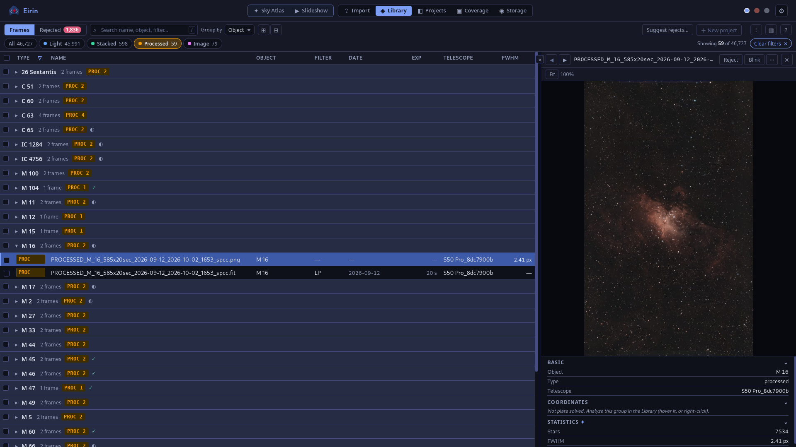
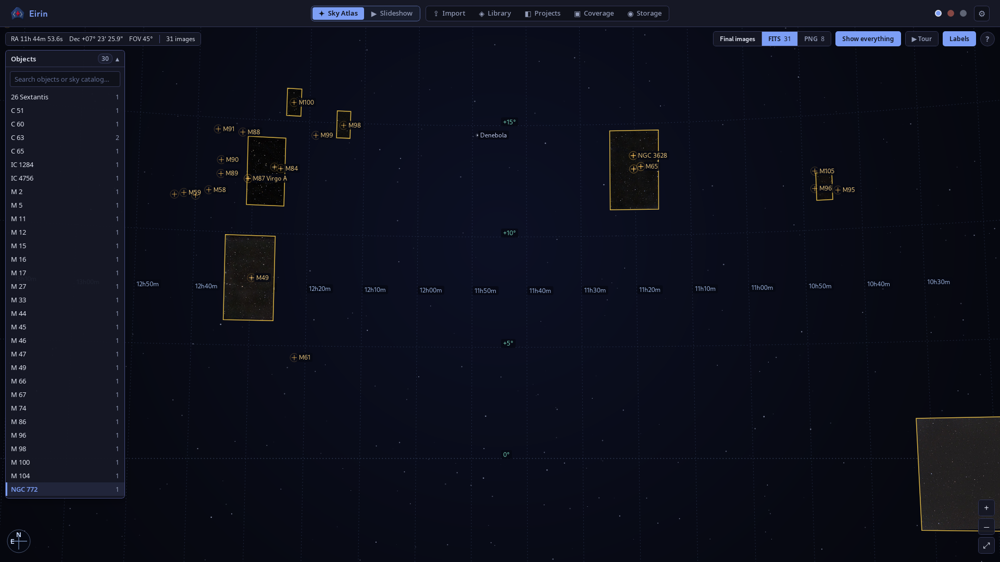

# Eirin

[](https://github.com/hawawa4/eirin/actions/workflows/ci.yml)
[](https://github.com/hawawa4/eirin/releases)
[](LICENSE.md)

Eirin is a desktop app for managing astrophotography data. It keeps your subs, calibration frames and finished images in one folder (ideally on a NAS), lets you preview and cull FITS frames, and builds the project folders [Siril](https://siril.org) needs for stacking. It doesn't stack or process anything itself.

It was built around the Seestar S30 Pro and S50 Pro, so that's the workflow it fits best. Other cameras may work, but they haven't been tested much.

Website: <https://eirin.hawawa.org>



## Contents

- [What it does](#what-it-does)
- [Install](#install)
- [Getting started](#getting-started)
- [Headless server](#headless-server)
- [Building from source](#building-from-source)
- [Project layout](#project-layout)
- [Configuration](#configuration)
- [Similar software](#similar-software)

## What it does

You pick a root folder. Eirin reads the FITS headers into a local SQLite database and leaves the files where they are. Everything else works from that index.

| View | What it's for |
|------|---------------|
| **Library** | Every frame under the root, grouped by object, date, filter or type, with filters and search. Preview the selected frame, blink through a set, reject frames (hidden, not deleted) or delete them for good. With Siril installed, *Analyze* measures star FWHM and plate-solves frames, and *Suggest rejects* flags frames whose FWHM is well above the rest of their group. |
| **Import** | Copies files from a Seestar into the library. It shows what will be copied and where before it does anything, and skips files the library already has. It can delete from the device afterwards, but only once a full SHA-256 of the copy matches the original. |
| **Projects** | A project is a local folder with `lights/`, `darks/`, `flats/` and `biases/`, with the frames symlinked from the NAS (or copied, if you prefer). Open it in Siril, then import the results back into the library. |
| **Sky Atlas** | Your plate-solved public images (the ones you marked ★ Public in the Library) drawn where they really are on a chart of the sky, with bright stars and Messier/NGC objects for reference. Useful for seeing what you've covered and where the gaps are. It isn't a planetarium. |
| **Coverage** | Light frames grouped by framing and telescope, drawn as outlines on the sky. Good for finding data of the same target filed under different names, or the panels of a mosaic, and turning a selection into a project. |
| **Storage** | A treemap of disk usage per target, broken down by night and frame type. |
| **Browse** | The root folder as a plain folder tree, with the same preview, reject and delete actions. |
| **Slideshow** | Your finished images as a full-screen slideshow. |

Other details:

- FITS preview with four stretch levels, debayering of one-shot-colour frames, zoom and pan, and the main header fields at a glance.
- A red theme for use at the scope.
- Settings → Updates can check GitHub for a new release and install it. It only checks when you click the button.

Screenshots and short clips of each view are on the [website](https://eirin.hawawa.org).



## Install

### Linux

Download the latest build from the [Releases page](https://github.com/hawawa4/eirin/releases):

- **`.deb`** (Debian, Ubuntu and derivatives): `sudo apt install ./eirin-linux-amd64.deb`
- **`.AppImage`**: `chmod +x eirin-linux-amd64.AppImage && ./eirin-linux-amd64.AppImage`
- **`.zip`**: extract it and run the `eirin` binary

All three need `libwebkit2gtk-4.1-0` (the `.deb` pulls it in for you).

### Windows and macOS

No packages are published yet. The app builds on both with `wails3`, but that isn't tested in CI. See [Building from source](#building-from-source).

### Siril

Needed for plate-solving, FWHM analysis and opening projects. Eirin finds it on your `PATH`, or you can point it at the binary in Settings. Without Siril you can still import, browse, preview, cull and use the atlas for frames that already have coordinates in their headers.

## Getting started

1. **Choose a root folder** in Settings. Subs, calibration frames, stacks and final images all live here. A NAS share works well. Choose a local projects folder too, for the Siril projects.
2. **Import** from the Seestar. The device shares its storage over SMB, so mount it and pick the mount point as the source (see below).
3. **Go through the frames** in the Library and reject the bad ones.
4. **Create a project** from the selected or filtered frames, open it in Siril and process as usual.
5. **Import the results** back into the library. Once they're plate-solved and marked ★ Public in the Library, they appear on the Sky Atlas.

<details>
<summary>Mounting the Seestar on Linux</summary>

Mount the share (needs `cifs-utils`) and pick that folder as the import source:

```sh
mkdir -p ~/mnt/seestar
sudo mount -t cifs -o guest,uid=$(id -u) "//seestar.local/EMMC Images/" ~/mnt/seestar
```

Unmount when you're done:

```sh
sudo umount ~/mnt/seestar
```

If `seestar.local` doesn't resolve, use the Seestar's IP address instead.

</details>

## Headless server

A public photo gallery for your finished images, for running on another machine such as the one next to your NAS: a grid of pictures with a full-size viewer, the Sky Atlas and a Slideshow. It's not the app with parts removed: the server build has no Library, no Settings and no way to change anything. Visitors only ever see the final images you marked as public, under opaque ids: no folder or file names, and no raw or calibration frames. There's no login or TLS, so put it behind your own reverse proxy if you expose it.

It never shares the desktop's database. The desktop app publishes a snapshot, and the server loads it:

1. In the desktop app, choose what to show: in the Library, select your processed images and click **★ Public** (or press `p`, or right-click → Show in public gallery). Nothing is public until you mark it, and the **Public** chip next to the type chips filters to what is. Then turn on **Settings → Server viewer**. It writes a copy of the library database to `<library>/.eirin/library.db` shortly after changes and when the app closes.
2. Run the server with the library mounted. Images are published to `ghcr.io/hawawa4/eirin-server` on tagged releases:

   ```yaml
   services:
     eirin-server:
       image: ghcr.io/hawawa4/eirin-server:latest
       restart: unless-stopped
       ports:
         - "8080:8080"
       volumes:
         - /mnt/nas/Astro:/library:ro   # your library; the path doesn't need to match the desktop's
         - ./eirin-data:/data           # the server's local copy of the snapshot, preview cache and gallery.json
       environment:
         EIRIN_GALLERY_TITLE: "My night sky"
         EIRIN_GALLERY_SUBTITLE: "Seestar S50 astrophotography"
         EIRIN_GALLERY_HOME_URL: "https://eirin.example.org"
   ```

3. Open `http://<server>:8080`. The server checks for a new snapshot every minute, copies it, rewrites the file paths to where the library is mounted on the server, keeps only the images marked public, and swaps it in. Open browser tabs refresh by themselves.

The gallery is configured by environment variables, by a JSON file, or both (the variables win). The file is `/data/gallery.json`, or wherever `EIRIN_GALLERY_CONFIG` points; editing it needs a restart.

| Variable | JSON key | Default | Purpose |
|----------|----------|---------|---------|
| `EIRIN_GALLERY_TITLE` | `title` | `Astrophotography` | Name in the header and the page title |
| `EIRIN_GALLERY_SUBTITLE` | `subtitle` | none | A line under the title on the front page |
| `EIRIN_GALLERY_ABOUT` | `about` | none | A few sentences on the front page; blank lines separate paragraphs |
| `EIRIN_GALLERY_THEME` | `theme` | `blue` | `blue`, `red` or `grey` |
| `EIRIN_GALLERY_VIEW` | `view` | `grid` | Page it opens on: `grid`, `atlas` or `slideshow` |
| `EIRIN_GALLERY_FORMAT` | `format` | `auto` | Which rendering to show. The library often holds a final image twice, as processed FITS and as a PNG/JPEG/TIFF export. `auto` shows the exports when there are any, `raster` or `fits` force one |
| `EIRIN_GALLERY_HOME_URL` | `homeUrl` | none | Adds a link in the header (an `http(s)` URL or a path on the same site), e.g. back to your landing page |
| `EIRIN_GALLERY_HOME_LABEL` | `homeLabel` | `About this project` | Text of that link |

```json
{ "title": "My night sky", "subtitle": "Seestar S50", "theme": "red", "view": "slideshow" }
```

Pictures can be linked to: `/#/atlas`, `/#/slideshow`, or `/#/image/<id>` (what the address bar shows while a picture is open). The Sky Atlas shows the plate-solved pictures; PNG/JPEG exports carry no coordinates, so if only the FITS files are solved those are what the Atlas draws.

## Building from source

### Prerequisites

| Tool | Version |
|------|---------|
| Go | 1.26+ |
| Node.js | 22+ |
| [Wails CLI](https://v3alpha.wails.io) | v3 (alpha) |
| [just](https://github.com/casey/just) | any recent |
| staticcheck | for `just lint` |

On Linux you also need the WebKit GTK development package: `sudo apt install libwebkit2gtk-4.1-dev` (Ubuntu 22.04+ and derivatives).

Wails v3 defaults to GTK4 on Linux. This project targets GTK3/webkit2gtk-4.1 instead, via the `gtk3` build tag, which `build/linux/Taskfile.yml` passes automatically. The Wails CLI has to be installed with the same tag, or it will look for GTK4 headers. Omit the tag on macOS and Windows.

```sh
go install -tags gtk3 github.com/wailsapp/wails/v3/cmd/wails3@latest
go install honnef.co/go/tools/cmd/staticcheck@latest
just install-backend
just install-frontend
```

The `Justfile` puts `~/go/bin` and `/usr/local/go/bin` on `PATH`, so the tools are expected to be installed there.

### Commands

Everything goes through `just`. Run `just` on its own to list every recipe.

| Command | |
|---------|-|
| `just dev` | Live-reload dev mode: Go recompiles on save, Vite handles Svelte HMR |
| `just build` | Production build with `wails3 build`; output goes to `build/bin/` |
| `just build-backend` / `just build-frontend` | Only the Go side, or only the Svelte side |
| `just test` | Go unit tests (`go test ./internal/...`) |
| `just test-server` | The same tests against the headless build (`-tags server`) |
| `just check` | Type-check Go and TypeScript (`svelte-check` + `tsc`) |
| `just lint` / `just format` | staticcheck, ESLint and Prettier check / Prettier write |
| `just build-gallery` | The gallery frontend (`frontend/dist-gallery`), which the server build embeds |
| `just build-server` | Headless binary, `eirin-server` (run `just build-gallery` first) |
| `just docker-build` | Extract the static server binary to `./dist/` |
| `just bindings` | Regenerate the Wails TypeScript bindings |

CI runs lint, type-check and both test suites on pull requests. To run one Go test: `go test ./internal/store/... -run TestName`.

To build the server image locally instead of pulling it: `docker build -t eirin-server .`

### Project layout

The backend is under `internal/`, split by responsibility. `app` is the Wails-bound layer and should stay thin glue; put new logic in its own package.

| Package | Responsibility |
|---------|----------------|
| `app` | Wails service: `*App` methods, events, dialogs; in the server build, the `Gallery` service |
| `gallery` | The public gallery's pure logic: configuration, opaque image ids, metadata read from file names |
| `store` | SQLite database: frames, projects, preferences |
| `importer`, `indexer` | Scanning and copying files from the device; FITS file detection |
| `fits` | FITS parsing, pixel processing, previews |
| `siril` | Siril detection, execution and output parsing |
| `projectfs` | Building project folders and symlinks |
| `catalog`, `coverage`, `telescopes` | Star and object catalogue, annotations, moon phase; framing clustering for the Coverage view; identifying the Seestar model from a frame's field of view |
| `fileman` | Reveal files and open folders in the OS file manager |
| `snapshot` | Library snapshot: the desktop publisher and the server loader |
| `server` | The REST API (desktop only) |
| `updater` | GitHub release check and in-place install |

The frontend is Svelte and TypeScript in `frontend/`. The bindings in `frontend/bindings/` are generated by Wails; don't edit them by hand.

Conventions worth knowing:

- Tests are whitebox (same package), one `_test.go` per source file. They use `newTestStore(t)` / `newTestApp(t)`, which build a database in `t.TempDir()`, and every package with database tests sets `EIRIN_DB_PATH` to a temp path in `TestMain`. Tests must never touch the real database.
- The server build is a different program from the desktop app, not the app in read-only mode. It binds only the `Gallery` service to Wails (`main_server.go`), so none of `App`'s methods are reachable, and it embeds its own frontend (`frontend/dist-gallery`, built from `frontend/gallery/` by `vite.gallery.config.ts`). Visitors address pictures by opaque ids (`gallery.PublicPath`), never by path; the preview route resolves them, and refuses anything else. Don't add anything to `Gallery` that returns a path, a file name or a frame that isn't a final image. As defence in depth, `App`'s own write methods still start with `a.requireWritable()` and path-taking reads call `a.checkServable(path)`; add the right guard to any new method of those kinds. Things that can't work headlessly (Siril, import, reveal in file manager) are split into `_desktop.go` / `_server.go` files behind `//go:build !server` and `//go:build server`.
- The gallery reuses the desktop's Sky Atlas and Slideshow components. In the gallery bundle `$app` is replaced by `src/gallery/appShim.ts`, which answers the same calls from the gallery service, and the components take a `gallery` prop that hides file names and desktop actions. Anything the shared code imports from `$app` has to exist in that shim.
- Persist frontend preferences through `savePref` in `lib/prefs.ts`. In the gallery it keeps them in `localStorage` instead of the database.
- Updates: release assets must be named `eirin-linux-amd64.{AppImage,deb,zip}`, which is what the updater looks for, and each download is verified against the release's `SHA256SUMS`.

### Website

The website is a separate [Astro](https://astro.build) site in `landingpage/`, built to static files and served by nginx (`ghcr.io/hawawa4/eirin-landingpage`). It reuses the screenshots in `docs/img/` and the clips in `docs/vid/`, so retaking one updates both the site and this README.

```sh
just install-landing
just landing-dev     # dev server
just landing-build   # static build into landingpage/dist/
just landing-docker  # build the nginx image locally
```

## Configuration

| Variable | Default | Purpose |
|----------|---------|---------|
| `EIRIN_DB_PATH` | Platform config dir (see below) | Where the SQLite database lives |
| `EIRIN_PORT` | `7070` | Desktop only: port for the REST API (`/api/status`, `/api/frames`, `/api/image`). Set it if 7070 is taken. The server build has no REST API |
| `EIRIN_ROOT` | `/library` in the image | Server build only: where the library is mounted. Required |
| `WAILS_SERVER_HOST`, `WAILS_SERVER_PORT` | `0.0.0.0`, `8080` in the image | Server build only: the web UI listener |
| `EIRIN_CACHE_DIR` | See below | Where rendered previews are cached (in a `previews` folder inside it) |
| `EIRIN_PREVIEW_CACHE_MB` | `2048` | Size limit of the preview cache; least recently viewed images go first. `0` turns the disk cache off |
| `EIRIN_PREVIEW_WARM` | on | Server build only: `0` stops it from rendering the gallery's previews in the background after each snapshot |
| `EIRIN_GALLERY_*`, `EIRIN_GALLERY_CONFIG` | | Server build only: the gallery's title, texts and theme; see [Headless server](#headless-server) |

The server image defaults `EIRIN_DB_PATH` to `/data/library.db`. That file is disposable, as it's rebuilt from the next snapshot. Rendered previews are cached next to it in `/data/previews` (on the desktop: `~/.cache/eirin/previews` on Linux, the platform cache directory elsewhere), so they survive restarts; deleting the folder is always safe.

Default database location:

| Platform | Path |
|----------|------|
| Linux | `~/.config/eirin/prefs.db` |
| macOS | `~/Library/Application Support/eirin/prefs.db` |
| Windows | `%AppData%\eirin\prefs.db` |

The desktop app runs two separate HTTP listeners: Wails' own, which serves its UI, and the REST API (`EIRIN_PORT`). The server build only has the first (`WAILS_SERVER_PORT`).

## About the code

A good part of this was written with AI assistance, especially the frontend. It's also my first Wails project. I'm comfortable with backend and systems work, much less so with frontend.

I built it for my own Seestar data, so bug reports and suggestions are welcome but I can't promise to act on anything beyond what I need. [Open an issue](https://github.com/hawawa4/eirin/issues/new/choose) if you're using it and run into something.

## Similar software

- [Astro Catalogue Viewer](https://github.com/thebioguy/Astro-Catalogue-Viewer): catalogues your images automatically, with a feel like a bird-watching journal. It doesn't help with processing, but it's very good for viewing finished images.
- [SSLM](https://github.com/AstroNoob-Tools/SSLM): Windows only, focused entirely on Seestars.

## License

MIT, see [LICENSE.md](LICENSE.md).
